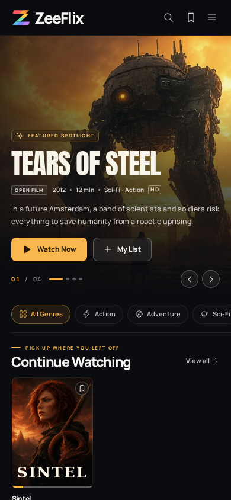

# ZeeFlix — Entertainment Without Limits (Official GitHub Repository)

**ZeeFlix** is a modern, lightweight streaming platform for **Web (Rust + WebAssembly + HTML5)** and **Native Android (Kotlin + Media3 ExoPlayer)** featuring an original seven-colour **Liquid Glass** UI, custom media player, authorized provider manager, and offline downloads.

- **Creator:** Zeeshan Haider
- **Class:** 9th Class
- **School:** Government High School No. 1
- **Teacher:** Waqas Ashraf
- **Project:** ZeeFlix — *Entertainment Without Limits.*

---

## Screenshots

### Home & Spotlight Carousel (Desktop & Mobile)
| Desktop Home | Mobile Home |
| :---: | :---: |
|  |  |

### Custom Player & Provider Manager
| Custom HTML5 / Media3 Player | Add & Test Media Providers |
| :---: | :---: |
|  |  |

### Instant Search & About ZeeFlix
| Instant Search & Filters | About ZeeFlix |
| :---: | :---: |
|  |  |

---

## Key Features

1. **Native Android App (`android/`):**
   - Built with **Kotlin**, **Material 3 Liquid Glass** cards, and **AndroidX Media3 ExoPlayer** (`mp4`, `webm`, `hls`, `dash`, plus sandboxed authorized embeds).
   - **Quick Provider Setup:** Add a direct video URL, HLS manifest, DASH stream, or authorized embed in the **Providers** tab and tap **Watch** immediately.
   - **Player Controls:** Play/Pause, seekbar, double-tap `±10s` gestures, speed (`0.5×`–`2×`), quality selector (actual available tracks `360p`–`4K`), subtitles, audio tracks, Picture-in-Picture (PiP), landscape fullscreen, resume playback, Continue Watching, and Next/Previous episode auto-play.
   - **Authorized Downloads:** Integrated with Android `DownloadManager` for permitted progressive titles.

2. **Rust + WebAssembly Web Platform (`src/`, `public/`, `dist/`):**
   - Zero-dependency Rust core (`~201 KiB` WASM) handling catalogue search, collections, provider validation, state persistence, and HTML rendering.
   - Lazy-loaded WebP poster artwork, preloaded local WOFF2 fonts, on-demand `hls.js` / `dash.js`, and HTTP 206 byte-range downloads.

---

## Build & Run

### Web (Rust + WebAssembly)
```bash
cargo fmt --check
cargo clippy --all-targets -- -D warnings
cargo test --locked
npm ci --ignore-scripts
npm run test:web
npm run build
LD_LIBRARY_PATH=/tmp/al2023/lib npm run test:browser
```

### Native Android APK (`android/`)
Open `android/` in **Android Studio** or run Gradle from `android/`:
```bash
cd android
gradle testDebugUnitTest lintDebug assembleDebug
```
The compiled debug APK is also automatically built and uploaded as the **`ZeeFlix-Android-APK`** artifact in **GitHub Actions**.

---

## Documentation & Reports

- [Automated Test & Performance Report](docs/TEST_AND_PERFORMANCE_REPORT.md)
- [Student Pack Domain & Deployment Status](docs/DOMAIN_AND_DEPLOYMENT_REPORT.md)
- [Film Credits & Attributions](public/credits.html)
