<div align="center">

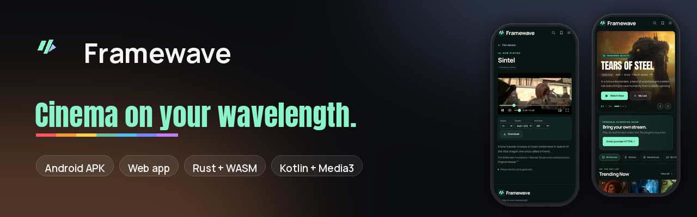

# Framewave

### Cinema on your wavelength.

**A streaming app for Android and the web — built from scratch by a 9th-class student.**

[](https://github.com/flixybuild-lgtm/ZeeFlix/releases/latest/download/ZeeFlix-latest.apk)
[](https://flixybuild-lgtm.github.io/ZeeFlix/)
[](https://flixybuild-lgtm.github.io/ZeeFlix/install.html)

[](https://github.com/flixybuild-lgtm/ZeeFlix/releases)


**No account. No ads. No subscriptions. No trackers. Just films.**

</div>

---

## 📲 Install in 30 seconds

| You want… | Do this |
| :--- | :--- |
| **Android app** | **[Download `ZeeFlix-latest.apk`](https://github.com/flixybuild-lgtm/ZeeFlix/releases/latest/download/ZeeFlix-latest.apk)** → open it → allow *install unknown apps* → Install. <br><sub>Android 7.0+ · 45 MB · arm64 + armv7</sub> |
| **Nothing to install** | **[Open the web app](https://flixybuild-lgtm.github.io/ZeeFlix/)** — works in Chrome, Safari, Firefox, Edge. |
| **Home-screen app** | Open the web app → browser menu → **Add to Home screen**. |
| **Full walkthrough** | **[Install guide with screenshots, FAQ & checksums](https://flixybuild-lgtm.github.io/ZeeFlix/install.html)** |
| **Own domain** | **[Free `.dpdns.org` domain guide](docs/FREE_DOMAIN_SETUP.md)** — DigitalPlat FreeDomain → Cloudflare → GitHub Pages |

> **Verify your download:** every release publishes `SHA256SUMS.txt` next to the APK. Only install builds from this repository's own [Releases](https://github.com/flixybuild-lgtm/ZeeFlix/releases) page.

---

## Play your own provider link

Choose **Enter provider HTTPS** on Home. Paste an authorized HTTPS media URL, check the permission box and save it. The suggested display title is **Zenda-Cross**; change it for other providers. A name alone does not route playback, and a Vega plugin repository is not a video URL.

Auto detects WebM, HLS, DASH and supported official embeds; other URLs use direct playback. Choose the format yourself if the link has no file extension. On Android choose **Save & Watch**; on the web select **Watch →** beside the saved provider. Saved sources can be tested, disabled, edited or removed under Providers.

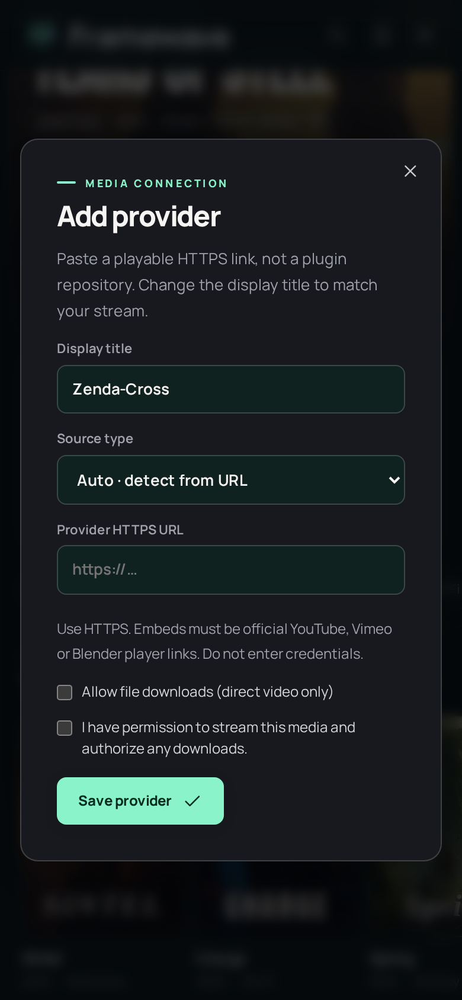

## ▶️ See it move

<div align="center">
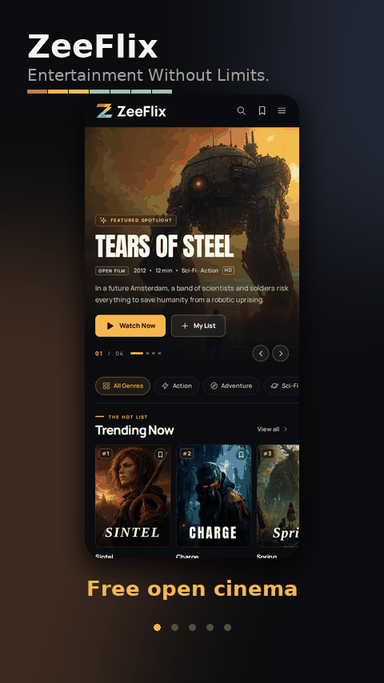
</div>

<sub>Ten seconds through the real app — captured with the same harness that produces every screenshot below.</sub>

---

## ✨ Why it feels different

<div align="center">
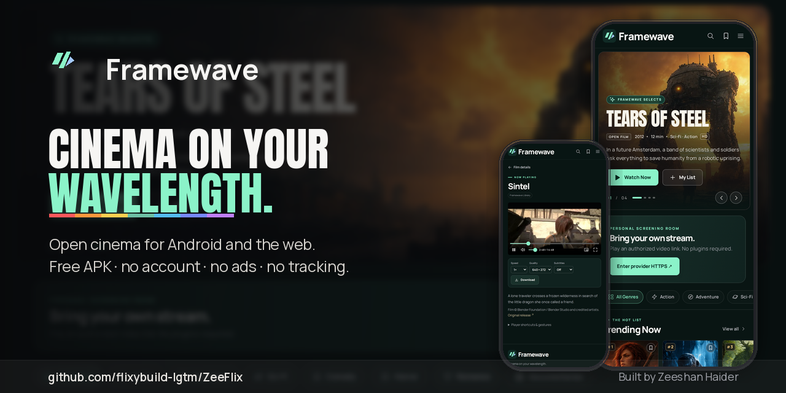
</div>

- **A real app, not a template.** Kotlin + Jetpack + **AndroidX Media3 ExoPlayer** on Android; **Rust compiled to WebAssembly** on the web. Same catalogue, same design language, two engines.
- **Screening-room UI** with a mint signal mark, custom poster art and the Anton / Manrope / Bebas Neue type system. Light enough to load instantly, dense enough to feel like a paid product.
- **Plays almost anything.** MP4, WebM, HLS and DASH with real quality switching, subtitle tracks, audio tracks, `0.5×–2×` speed, ±10 s double-tap seeking, Picture-in-Picture and resume-where-you-left-off.
- **Your own sources.** Add a direct video link, an HLS/DASH manifest or an official embed you are allowed to use, test the connection, then press play. Nothing is scraped, proxied or decrypted.
- **Offline when permitted.** Authorized progressive files download through the Android `DownloadManager` with pause/resume; the web app streams with resumable byte ranges.
- **Private by architecture.** No login, no analytics SDK, no ad network. Lists, favorites, watch positions and provider links live on your device.

---

## 📸 Screenshots

<div align="center">

### Mobile

| Home & spotlight | Player controls | Providers |
| :---: | :---: | :---: |
|  | 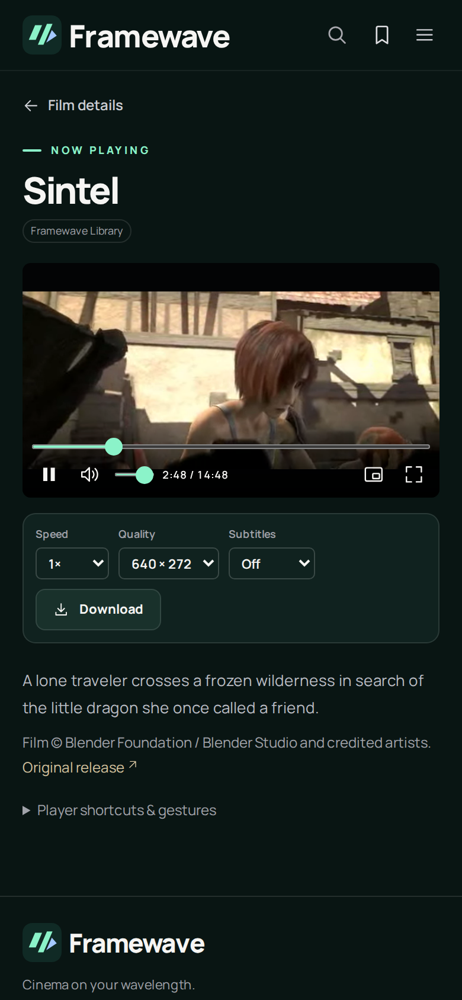 | 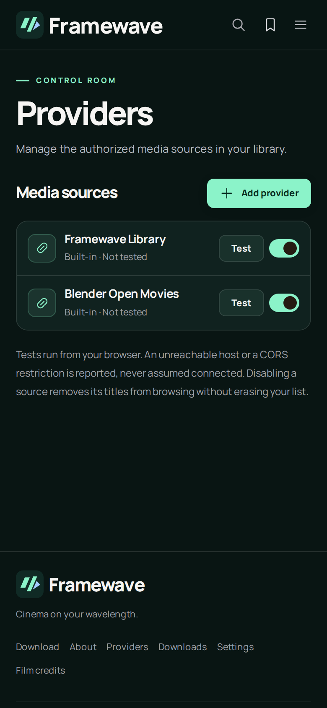 |
| **Title details** | **Instant search** | **Downloads** |
|  | 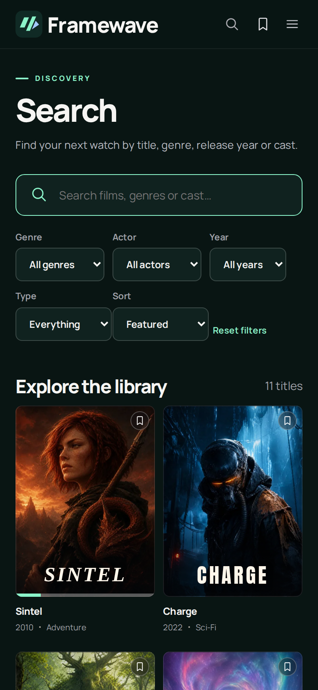 |  |

### Desktop

| Home & spotlight carousel | Custom HTML5 / Media3 player |
| :---: | :---: |
|  |  |

| Add & test media providers | Instant search & filters |
| :---: | :---: |
| 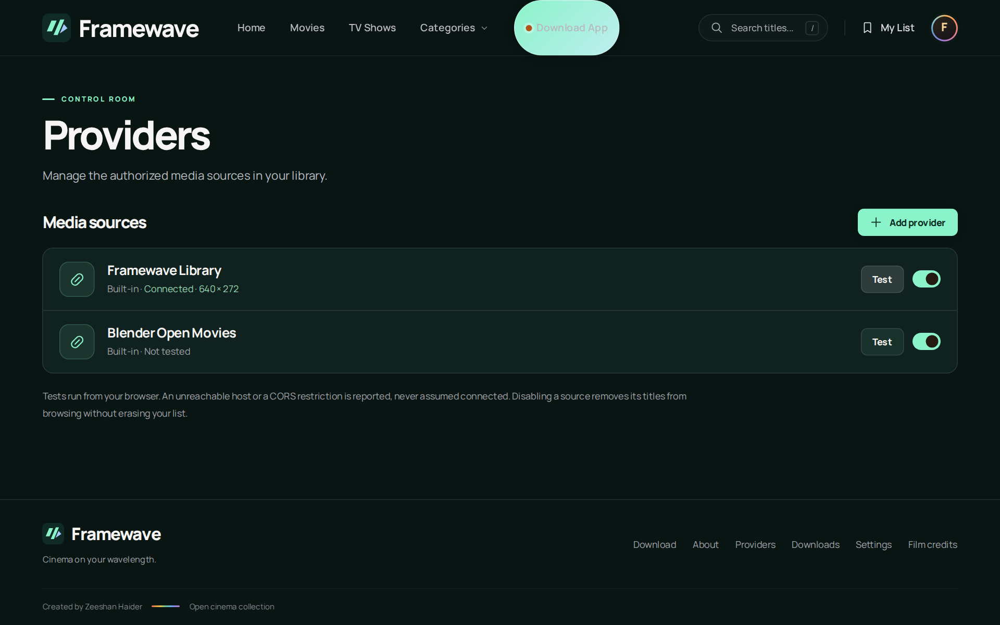 | 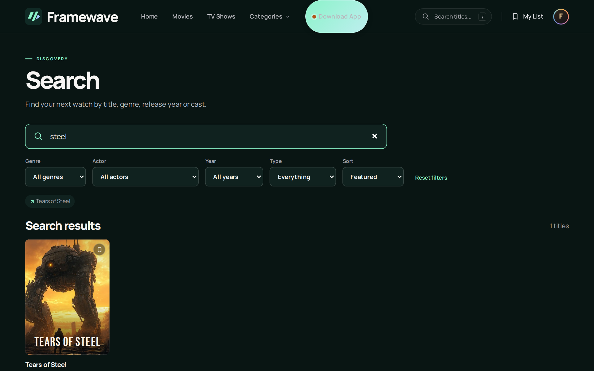 |

| Film details | About Framewave |
| :---: | :---: |
| 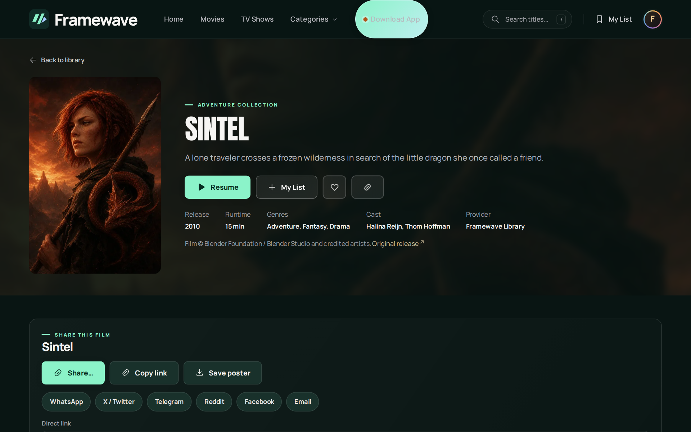 | 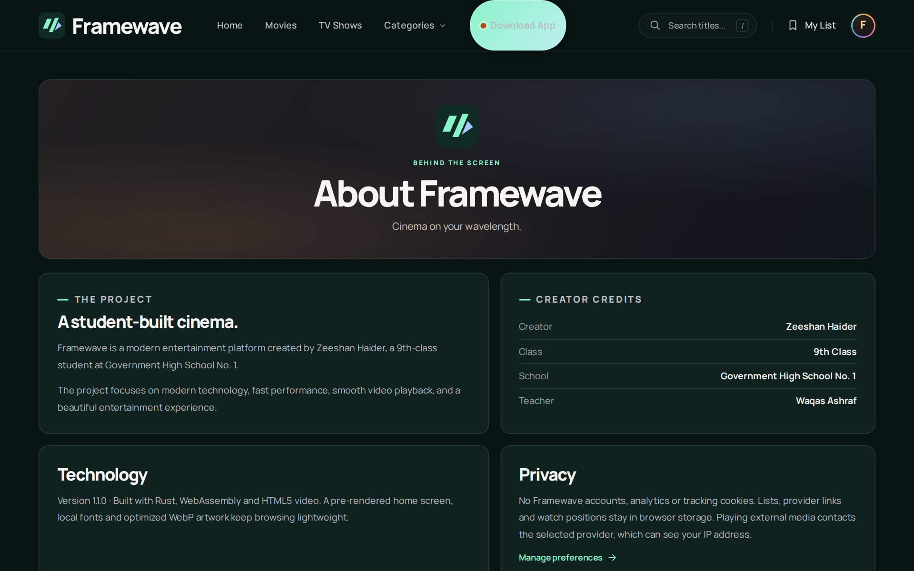 |

</div>

<sub>Screenshots are captured from the real running app by [`scripts/screenshots.mjs`](scripts/screenshots.mjs) — nothing here is a mockup.</sub>

---

## 🎬 What's inside

Twelve hand-picked films from the **Blender open-movie collection**, playable instantly with subtitles and credits retained:

`Sintel` · `Tears of Steel` · `Big Buck Bunny` · `Spring` · `Cosmos Laundromat` · `Charge` · `Agent 327` · `Sprite Fright` · `Caminandes: Gran Dillama` · `Caminandes: Llamigos` · `The Making of Sintel`

All films are published under Creative Commons licences by the Blender Foundation. Rights stay with their creators — see **[credits & attributions](https://flixybuild-lgtm.github.io/ZeeFlix/credits.html)**.

---

## 🛠️ Build it yourself

### Web — Rust + WebAssembly

```bash
npm ci --ignore-scripts
npm run build          # cargo → wasm, pre-render, bundle, service worker
npm start              # preview on http://0.0.0.0:4173
npm run test:web       # unit tests (sources, downloads, player helpers)
npm run test:browser   # Playwright end-to-end suite
```

### Android — Kotlin + Media3

```bash
cd android
gradle testDebugUnitTest assembleDebug
# → app/build/outputs/apk/debug/app-debug.apk
```

Or skip the toolchain entirely: **Actions → “Publish Framewave APK & Screenshots” → Run workflow.** CI builds the APK, captures fresh screenshots, renders the marketing images and attaches everything to a GitHub Release.

---

## 🗺️ Architecture

```
src/                  Rust core  (catalogue, search, library, rendering) → WASM
public/               Hand-written UI: app.js, player.js, sources.js, downloads.js, CSS
templates/            Pre-rendered shell (SEO-friendly, no client-side router flash)
android/              Kotlin app: Splash → Main → Detail → Player (Media3 ExoPlayer)
scripts/              build.py · serve.py · screenshots.mjs · make_marketing.py · make_qr.py
docs/                 Screenshots, marketing assets, audit & performance reports
.github/workflows/    CI: Pages deploy · APK build · release publisher
```

The Rust boundary is deliberately tiny: the UI sends line-based commands (`page`, `hero`, `feed`, `results`, `detail`, `player`, `provider`, `dump`) and receives HTML or state strings back. That keeps the domain logic testable in plain `cargo test` while the DOM layer stays dumb and fast.

---

## 🤝 Contributing

Issues and pull requests are welcome — especially device reports (tell me your phone model and Android version), accessibility fixes and translations.

1. **Star the repo** ⭐ — it genuinely helps a student project get discovered.
2. **Report a bug** → [open an issue](https://github.com/flixybuild-lgtm/ZeeFlix/issues)
3. **Licence** → code is [MIT](LICENSE); films keep their Creative Commons licences.
4. **Read the audit** → [Android app audit](docs/ANDROID_APP_AUDIT.md) · [test & performance report](docs/TEST_AND_PERFORMANCE_REPORT.md) · [domain & deployment notes](docs/DOMAIN_AND_DEPLOYMENT_REPORT.md)

---

## 👤 The builder

<div align="center">

**Zeeshan Haider** — 9th Class
Government High School No. 1
Teacher: **Waqas Ashraf**

*“I wanted a streaming app that felt expensive but stayed free and private. So I built one.”*

</div>

---

<div align="center">

### ⭐ If Framewave made you smile, star it — that's the whole marketing budget.

<sub>Framewave is an independent student project. It is not affiliated with Google, the Play Store, Blender, or any film studio. Included films remain under their original Creative Commons licences; downloading a film is not a grant of new distribution rights.</sub>

</div>
