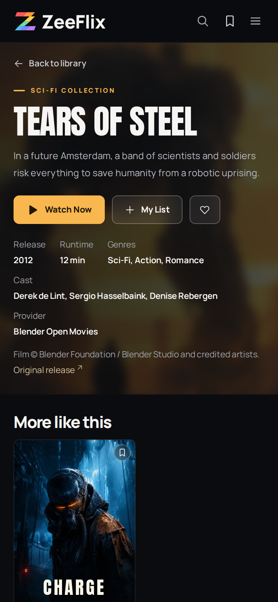
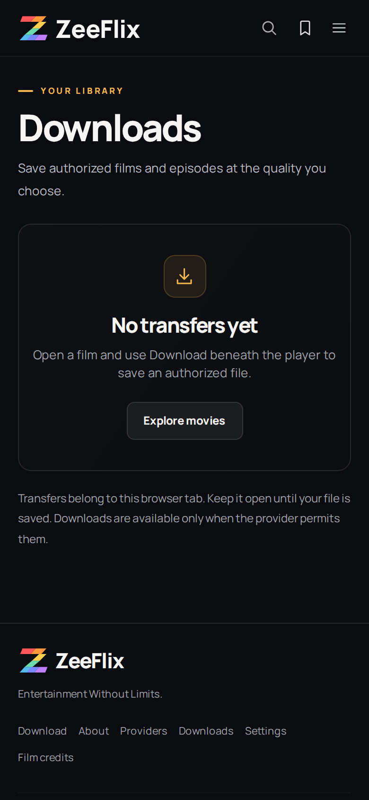
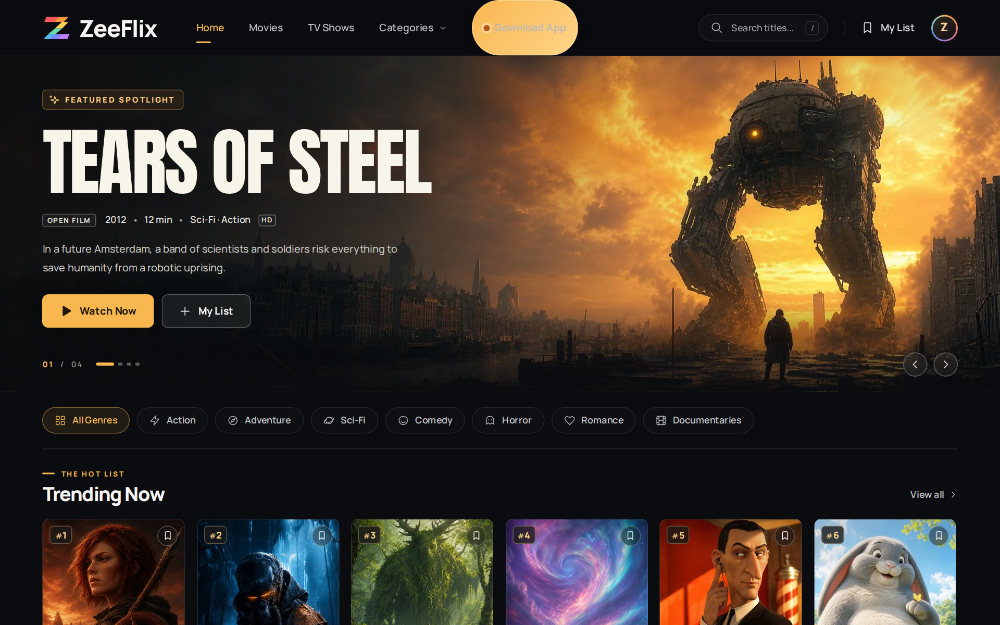
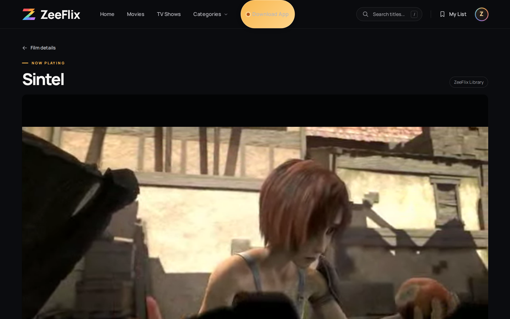

<div align="center">


# Framewave

### Cinema on your wavelength.

**A streaming app for Android and the web — built and adapted by a 9th-class student.**

[](https://github.com/flixybuild-lgtm/ZeeFlix/releases/latest/download/ZeeFlix-latest.apk)
[](https://flixybuild-lgtm.github.io/ZeeFlix/)
[](https://flixybuild-lgtm.github.io/ZeeFlix/install.html)

[](https://github.com/flixybuild-lgtm/ZeeFlix/releases)


**No account. No ads. No subscriptions. Just films.**

</div>

---

## 📲 Install in 30 seconds

| You want… | Do this |
| :--- | :--- |
| **Android app** | **[Download `ZeeFlix-latest.apk`](https://github.com/flixybuild-lgtm/ZeeFlix/releases/latest/download/ZeeFlix-latest.apk)** → open it → allow *install unknown apps* → Install. <br><sub>Android 9+ (API 28) · arm64 + armv7</sub> |
| **Nothing to install** | **[Open the web app](https://flixybuild-lgtm.github.io/ZeeFlix/)** — works in Chrome, Safari, Firefox, Edge. |
| **Home-screen app** | Open the web app → browser menu → **Add to Home screen**. |
| **Full walkthrough** | **[Install guide with screenshots, FAQ & checksums](https://flixybuild-lgtm.github.io/ZeeFlix/install.html)** |
| **Own domain** | **[Free `.dpdns.org` domain guide](docs/FREE_DOMAIN_SETUP.md)** — DigitalPlat FreeDomain → Cloudflare → GitHub Pages |

> **Verify your download:** every release publishes `SHA256SUMS.txt` next to the APK. Only install builds from this repository's own [Releases](https://github.com/flixybuild-lgtm/ZeeFlix/releases) page.

---

## Connect Zenda-Cross

**Android:** open **Settings → Providers** and install **VMovies**. Framewave preconfigures the official Zenda-Cross Vega provider source and exposes only that extension; there is no URL or JSON entry step. The extension is downloaded from Zenda-Cross at runtime, so first setup and updates need a network connection.

**Web:** the website remains a separate Rust/WebAssembly app and keeps its existing bridge flow. It still needs a running, trusted, compatible HTTPS `manifest.json` endpoint with CORS; a GitHub repo or video link is not a bridge endpoint. See the [Zenda-Cross bridge setup and troubleshooting guide](docs/VEGA_BRIDGE.md).

In **Settings**, you can opt into explicitly tagged 18+ results (off by default), clear watch history, and manage playback, downloads, privacy and appearance. On Firebase-configured Android builds, usage/crash reporting is off by default and can be opted into. Glass-like translucent surfaces keep Framewave’s visual style while the Android app uses the React Native / Expo engine.

**Android license:** the Vega-derived Android subtree is distributed under the upstream PolyForm Noncommercial License 1.0.0. This version is for noncommercial use only; monetization, ads, or commercial product use needs separate permission from Vega’s licensor. The web app and original repository code keep their own licenses. See [migration and license notes](docs/VEGA_ANDROID_MIGRATION.md).

## ▶️ See it move

<div align="center">

</div>

<sub>Ten seconds through the real app — captured with the same harness that produces every screenshot below.</sub>

---

## ✨ Why it feels different

<div align="center">

</div>

- **Two intentionally separate engines.** Framewave Android is a branded React Native / Expo adaptation of Vega; the website remains the independent Rust + WebAssembly app.
- **Screening-room UI** with a mint signal mark, custom poster art and the Anton / Manrope / Bebas Neue type system. Light enough to load instantly, dense enough to feel like a paid product.
- **Plays almost anything.** MP4, WebM, HLS and DASH with real quality switching, subtitle tracks, audio tracks, `0.5×–2×` speed, ±10 s double-tap seeking, Picture-in-Picture and resume-where-you-left-off.
- **One Android provider.** VMovies from the Zenda-Cross catalog is the only provider surfaced in the Android app. The web app keeps its own bridge requirements.
- **Offline when permitted.** Authorized progressive files download through the Android `DownloadManager` with pause/resume; the web app streams with resumable byte ranges.
- **Local-first.** Watch progress, lists and preferences are stored on the device. Provider modules and their source websites are external network dependencies.

---

## 📸 Screenshots

> **Refresh pending:** these mobile captures are from the previous Android engine. The Expo/Framewave UI has not yet completed an APK build in this sandbox; replace the mobile captures after the CI build is validated.

<div align="center">

### Mobile

| Home & spotlight | Player controls | Providers |
| :---: | :---: | :---: |
|  |  |  |
| **Title details** | **Instant search** | **Downloads** |
|  |  |  |

### Desktop

| Home & spotlight carousel | Custom web player |
| :---: | :---: |
|  |  |

| Add & test media providers | Instant search & filters |
| :---: | :---: |
|  |  |

| Film details | About Framewave |
| :---: | :---: |
|  |  |

</div>

<sub>Screenshots are captured from the real running app by [`scripts/screenshots.mjs`](scripts/screenshots.mjs) — nothing here is a mockup.</sub>

---

## 🎬 What's inside

Twelve hand-picked films from the **Blender open-movie collection**, playable instantly with subtitles and credits retained:

`Sintel` · `Tears of Steel` · `Big Buck Bunny` · `Spring` · `Cosmos Laundromat` · `Charge` · `Agent 327` · `Sprite Fright` · `Caminandes: Gran Dillama` · `Caminandes: Llamigos` · `The Making of Sintel`

All films are published under Creative Commons licences by the Blender Foundation. Rights stay with their creators — see **[credits & attributions](https://flixybuild-lgtm.github.io/ZeeFlix/credits.html)**.

---

## 🛠️ Build it yourself

### Web — Rust + WebAssembly

```bash
npm ci --ignore-scripts
npm run build          # cargo → wasm, pre-render, bundle, service worker
npm start              # preview on http://0.0.0.0:4173
npm run test:web       # unit tests (sources, downloads, player helpers)
npm run test:browser   # Playwright end-to-end suite
```

### Android — React Native / Expo

```bash
cd android-app
npm ci
npm run build:sandbox
npx tsc --noEmit
npm run lint:framewave
npx jest __tests__/manifestProviderPath.test.ts __tests__/settingsStorage.test.ts --runInBand
npx expo prebuild --platform android --clean --no-install
cd android
./gradlew testDebugUnitTest assembleDebug --no-daemon
# → android-app/android/app/build/outputs/apk/debug/vega-debug.apk
```

Requires Node 22, Java 17 and Android build tools. Minimum supported Android version is 9 (API 28).

Or skip the toolchain entirely: **Actions → “Publish Framewave APK” → Run workflow.** CI builds and verifies the Android APK, checks the app ID/signature/alignment, creates a SHA-256 manifest, and publishes the APK with its license notices on GitHub Releases.

---

## 🗺️ Architecture

```
src/                  Rust core  (catalogue, search, library, rendering) → WASM
public/               Hand-written UI: app.js, player.js, sources.js, downloads.js, CSS
templates/            Pre-rendered shell (SEO-friendly, no client-side router flash)
android-app/          Vega-derived React Native app: Expo, provider sandbox, playback, downloads and cast
scripts/              build.py · serve.py · screenshots.mjs · make_marketing.py · make_qr.py
docs/                 Screenshots, marketing assets, audit & performance reports
.github/workflows/    CI: Pages deploy · APK build · release publisher
```

The web app remains independent from the Android codebase. The Android provider is preconfigured for Zenda-Cross and filters the upstream manifest to its VMovies extension. See `docs/VEGA_ANDROID_MIGRATION.md` for attribution, version pin and license restrictions.

The Rust boundary is deliberately tiny: the UI sends line-based commands (`page`, `hero`, `feed`, `results`, `detail`, `player`, `provider`, `dump`) and receives HTML or state strings back. That keeps the domain logic testable in plain `cargo test` while the DOM layer stays dumb and fast.

---

## 🤝 Contributing

Issues and pull requests are welcome — especially device reports (tell me your phone model and Android version), accessibility fixes and translations.

1. **Star the repo** ⭐ — it genuinely helps a student project get discovered. The original web/repository code is [MIT](LICENSE); the Android subtree has its separate noncommercial license.
2. **Report a bug** → [open an issue](https://github.com/flixybuild-lgtm/ZeeFlix/issues)
3. **Licence** → original web/repository code and films retain their stated licences. The Vega-derived Android subtree has its own PolyForm Noncommercial license and must not be used commercially without separate permission.
4. **Read the audit** → [Android app audit](docs/ANDROID_APP_AUDIT.md) · [test & performance report](docs/TEST_AND_PERFORMANCE_REPORT.md) · [domain & deployment notes](docs/DOMAIN_AND_DEPLOYMENT_REPORT.md)

---

## 👤 The builder

<div align="center">

**Zeeshan Haider** — 9th Class
Government High School No. 1
Teacher: **Waqas Ashraf**

*“I wanted a streaming app that felt expensive but stayed free and private. So I built one.”*

</div>

---

<div align="center">

### ⭐ If Framewave made you smile, star it — that's the whole marketing budget.

<sub>Framewave is an independent student project. It is not affiliated with Google, the Play Store, Blender, or any film studio. Included films remain under their original Creative Commons licences; downloading a film is not a grant of new distribution rights.</sub>

</div>
