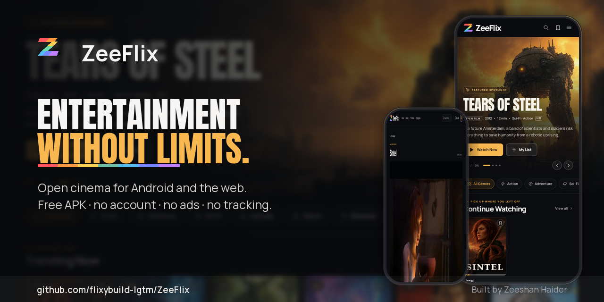

<div align="center">



# ZeeFlix 1.0.0

**Entertainment Without Limits — now on Android and the web.**

[](https://flixybuild-lgtm.github.io/ZeeFlix/)
[](https://flixybuild-lgtm.github.io/ZeeFlix/install.html)

</div>

## 📲 Download & install

| File | What it is |
| :--- | :--- |
| **`ZeeFlix-latest.apk`** | The Android app. Always the newest build — use this link. |
| `ZeeFlix-1.0.0-debug.apk` | Version-pinned copy of the same build. |
| `SHA256SUMS.txt` | Checksums. Verify before installing. |

**Steps**

1. Tap **`ZeeFlix-latest.apk`** on your phone (or scan the QR code on the [install page](https://flixybuild-lgtm.github.io/ZeeFlix/install.html)).
2. When Android asks, allow **install unknown apps** for your browser: *Settings → Apps → Chrome → Install unknown apps → Allow*.
3. Open the downloaded file → **Install** → **Open**.
4. Tap any poster to stream, or add your own source in **Providers**.

```bash
# Optional: verify the download on a computer
sha256sum ZeeFlix-latest.apk
cat SHA256SUMS.txt
```

> Android will show an "unknown developer" notice for any app installed outside the Play Store. That is expected for a direct APK — ZeeFlix is a free, non-commercial student project and does not ship through Google Play.

## ✨ What's new in 1.0.0

- **Native Android app** in Kotlin with **AndroidX Media3 ExoPlayer** — MP4, WebM, HLS and DASH playback with real quality, subtitle and audio-track selection.
- **Full gesture player** — double-tap either side to seek ±10 s, speed `0.5×–2×`, Picture-in-Picture, landscape fullscreen, resume playback and next/previous episode auto-play.
- **Liquid-glass UI** with the seven-colour ZeeFlix prism mark, custom poster art and lazy-loaded WebP artwork.
- **Provider manager** — add a direct video URL, HLS manifest, DASH stream or official embed you have permission to use; test the connection before you watch.
- **Authorized downloads** through Android `DownloadManager`, with pause/resume on the web.
- **Rust + WebAssembly web app** — zero-dependency core, pre-rendered shell, offline-capable service worker, byte-range streaming.
- **Privacy by default** — no accounts, no analytics, no ad SDKs. Only `INTERNET` and `ACCESS_NETWORK_STATE` permissions.

## 🎬 Included collection

`Sintel` · `Tears of Steel` · `Big Buck Bunny` · `Spring` · `Cosmos Laundromat` · `Charge` · `Agent 327` · `Sprite Fright` · `Caminandes: Gran Dillama` · `Caminandes: Llamigos` · `The Making of Sintel`

All titles are Creative Commons releases from the Blender Foundation and Blender Studio. Film rights remain with their creators — full attributions on the [credits page](https://flixybuild-lgtm.github.io/ZeeFlix/credits.html).

## 📱 Requirements

| | |
| :--- | :--- |
| Android | 7.0 (API 24) or newer · target API 35 |
| Architecture | arm64-v8a, armeabi-v7a, x86_64 |
| Download size | ~45 MB |
| Permissions | `INTERNET`, `ACCESS_NETWORK_STATE` only |
| Web | Any browser with WebAssembly + HTML5 video |

## 🐞 Known limitations

- The APK is **debug-signed** (auto-generated key), not Play-Store-signed. Android may show a notice when a newer build is installed over an older one from a different build machine; uninstall the old app first.
- HLS/DASH quality switching depends on the provider's published renditions.
- iOS has no native build yet — use the web app and **Add to Home Screen**.
- Downloads are limited to progressive files the provider explicitly permits.

## 💬 Feedback

Found a bug or want a feature? [Open an issue](https://github.com/flixybuild-lgtm/ZeeFlix/issues) — include your phone model and Android version. If ZeeFlix is useful to you, **star the repository**: it is how a student project gets seen.

<div align="center"><sub>Built by <b>Zeeshan Haider</b> · 9th Class · Government High School No. 1 · Teacher: Waqas Ashraf</sub></div>
